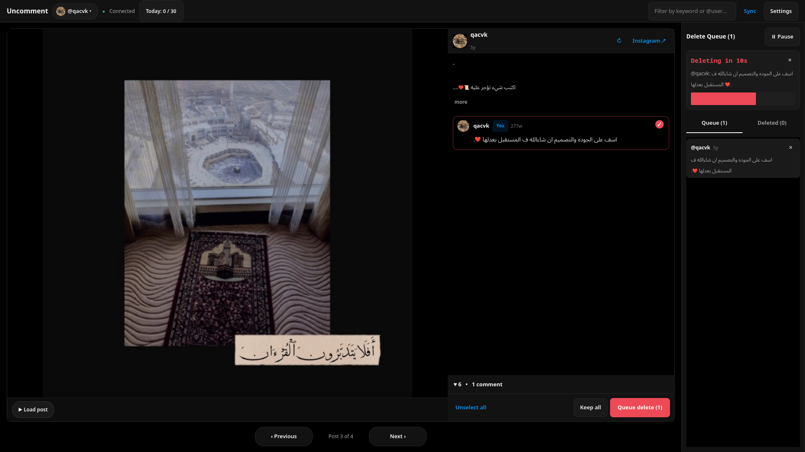
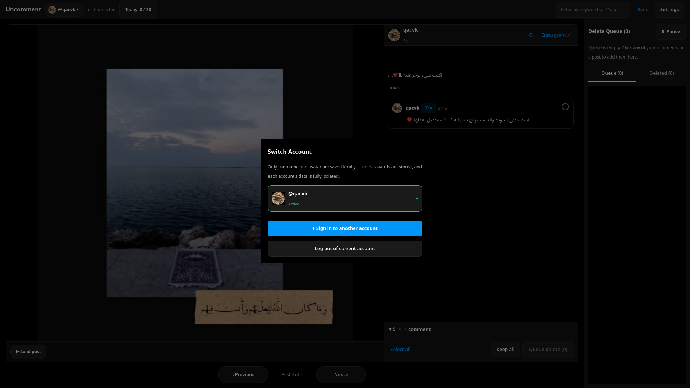

<div align="center">

# Uncomment

راجع تعليقاتك القديمة على إنستقرام ونظّفها بهدوء، محلياً بالكامل، وبدون ما تعرّض حسابك للخطر.

[](https://github.com/coder-samurai/Uncomment/releases)
[](LICENSE)
[](https://ko-fi.com/samuraicoder)

[English](README.md) · **العربية**

</div>

---

<div dir="rtl">

تنظيف تعليقاتك القديمة في إنستقرام من صفحة *نشاطك (Your Activity)* متعب جداً؛ الصورة صغيرة، ما تفهم سياق الردود، والحذف اليدوي واحد ورا الثاني ياخذ وقت طويل.

بنيت **Uncomment** عشان يحل هذي المشكلة. التطبيق يعرض لك تعليقاتك القديمة كبطاقات بوستات كاملة شبيهة بإنستقرام، وتختار اللي تبغى تحذفه وتخلي طابور الخلفية الآمن يتولى الباقي بهدوء.

## معاينة التطبيق

<p align="center">
  
</p>

<p align="center">
  
</p>

## التحميل المباشر (بدون برمجة)

حمّل النسخة المناسبة لجهازك من [صفحة الإصدارات (Releases)](https://github.com/coder-samurai/Uncomment/releases):

- **ويندوز (Windows):** حمّل `Uncomment-Windows-x64.zip` — فك الضغط وشغّل `Uncomment.exe`
- **ماك (macOS):** حمّل `Uncomment-macOS.zip` — فك الضغط وافتح `Uncomment.app`
- **لينكس (Linux):** حمّل `Uncomment-Linux-x64.tar.gz` — فك الضغط وشغّل `./Uncomment`

> **متطلب واحد فقط:** يكون عندك **Microsoft Edge** أو **Google Chrome** أو **Chromium** مثبّت على جهازك (يستخدمه التطبيق محلياً لإتمام تسجيل الدخول فقط).
>
> **بخصوص تحذير الحماية عند أول تشغيل:** لأن التطبيق مجاني ومفتوح المصدر بدون شهادة توقيع تجارية مدفوعة، قد يظهر تحذير في ويندوز (*Windows protected your PC*) — اضغط **More info ← Run anyway**. وعلى ماك انقر بزر الفأرة الأيمن على `Uncomment.app` واختر **Open**.

## وش يسوي التطبيق؟

- **تشوف البوست كامل مع سياقه:** صورة المنشور، الوصف، عدد اللايكات والتعليقات، وسلسلة الردود كاملة قبل ما تقرر.
- **الـ GIF وصور التعليقات والفيديو:** يشغّل تعليقات الـ GIF مباشرة (ويحفظ المحذوف منها محلياً في الأرشيف)، ويعرض صور التعليقات، ويحمّل الفيديو أو السلايدات فقط لما تضغط **Load post**.
- **مصمم لحماية حسابك من الحظر:** ما يحذف دفعة وحدة أبداً؛ يحذف تعليق واحد في الخلفية بفاصل عشوائي يحاكي الإنسان (12–35 ثانية)، مع عداد تنازلي، زر إلغاء فوري (`×`)، وحد يومي تتحكم فيه بنفسك (الافتراضي 20–30 تعليق باليوم).
- **إيقاف تلقائي 24 ساعة:** لو أرسل إنستقرام أي إشارة ضغط أو تحدي أمان، التطبيق يوقف نفسه تلقائياً لمدة 24 ساعة.
- **محلي 100% وبخصوصية كاملة:** صفر خوادم خارجية، صفر تتبع، ولا يحفظ كلمات مرور. تسجل الدخول من صفحة إنستقرام الرسمية، والنافذة تقفل نفسها تلقائياً أول ما يدخل الحساب.
- **أكثر من حساب:** تقدر تبدّل بين حساباتك بسهولة، وكل حساب له قاعدة بيانات وكاش وطابور حذف وحد يومي معزول تماماً.
- **تخصيص وفرز مريح:** استعرض عشوائياً أو من الأقدم للأحدث أو العكس، ابحث بكلمة أو `@username`، وبدّل بين **العربية والإنجليزية** و**3 ثيمات** (Instagram Dark، Pure OLED، Light).
- **تصفير بضغطة زر:** تقدر تمسح كاش الصور أو تصفّر كل البيانات وجلسة المتصفح من **الإعدادات ← البيانات والتنظيف**.

## الفرق بين أزرار المراجعة

| الزر | وش يسوي؟ |
| :--- | :--- |
| **Next / Previous (التالي / السابق)** | يتخطى البوست مؤقتاً بدون حفظ قرار — يرجع يطلع لك بعدين. |
| **Keep all (إبقاء الكل)** | يحفظ تعليقاتك في هذا البوست كـ «مُبقاة» وما عاد يعرضه لك مرة ثانية. |
| **Queue delete (إضافة للحذف)** | يضيف التعليقات المحددة لطابور الحذف الخلفي ويُبقي الباقي. |

## اختصارات لوحة المفاتيح

| الاختصار | الوظيفة |
| :--- | :--- |
| `←` / `→` | البوست السابق / التالي |
| `A` | تحديد أو إلغاء تحديد كل تعليقاتك في البوست الحالي |
| `Enter` | إضافة التعليقات المحددة لطابور الحذف |
| `R` | إعادة تحميل الردود والإحصائيات للبوست الحالي |
| `O` | فتح البوست على إنستقرام في المتصفح |

## التشغيل من الكود المصدري (للمطورين)

يتطلب **Python 3.11+**.

</div>

```bash
git clone https://github.com/coder-samurai/Uncomment.git
cd Uncomment

python -m venv .venv
source .venv/bin/activate        # Windows: .venv\Scripts\activate

pip install -r requirements.txt
playwright install chromium      # Optional if Chrome, Edge, or Chromium is installed

python src/main.py
```

<div dir="rtl">

## دعم المشروع

تطبيق **Uncomment** مجاني ومفتوح المصدر بالكامل. إذا وفّر عليك ساعات من التصفح وحاب تدعم التحديثات القادمة بشكل اختياري، تقدر تدعمني على Ko-fi:

</div>

<div align="center">

[](https://ko-fi.com/samuraicoder)

</div>

<div dir="rtl">

## إخلاء مسؤولية والرخصة

الأداة تشتغل عبر جلسة متصفحك المحلية لتنظيف حسابك الشخصي فقط — التزم دائماً بحد يومي محافظ. **Uncomment** مشروع مستقل مفتوح المصدر وغير تابع لشركة Instagram أو Meta.

منشور تحت [رخصة MIT](LICENSE).

</div>