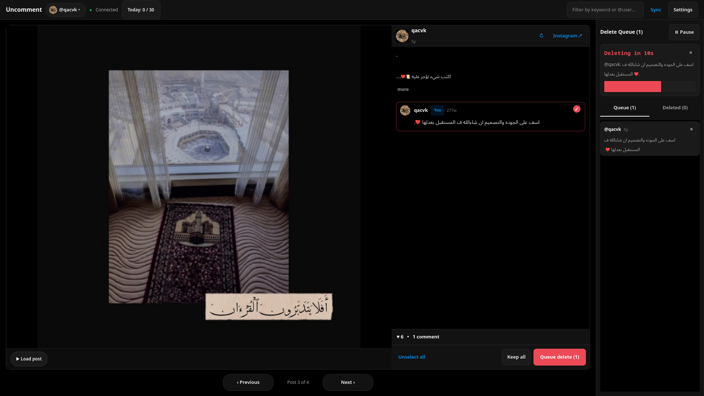
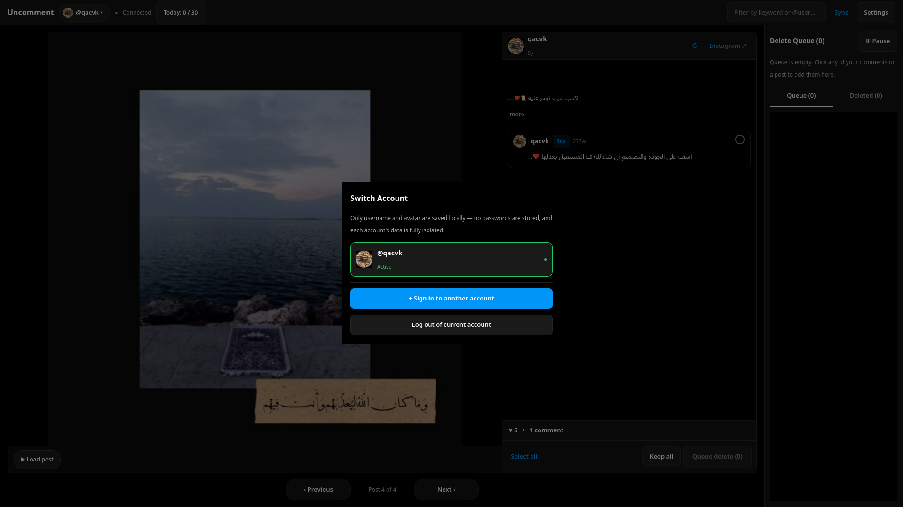

<div align="center">

# Uncomment

Review and clean up your old Instagram comments quietly, locally, and without risking your account.

[]([https://github.com/coder-samurai/Uncomment/releases](https://github.com/coder-samurai/Uncomment/releases))
[](LICENSE)
[](https://ko-fi.com/samuraicoder)

**English** · [Arabic](README.ar.md)

</div>

---

Cleaning up years of old comments through Instagram's *Your Activity* page is painful. The thumbnails are tiny, you lose the reply context, and deleting everything manually takes forever.

I built **Uncomment** to make it effortless. It pulls your comment history into a clean desktop app where you can see the actual post, read the thread, and let a safe background queue handle the deletions for you.

## Preview

<p align="center">
  
</p>

<p align="center">
  
</p>

## Download (No Coding Required)

Grab the latest build for your system from the [Releases page](https://github.com/coder-samurai/Uncomment/releases):

- **Windows:** `Uncomment-Windows-x64.zip` — unzip and run `Uncomment.exe`
- **macOS:** `Uncomment-macOS.zip` — unzip and open `Uncomment.app`
- **Linux:** `Uncomment-Linux-x64.tar.gz` — extract and run `./Uncomment`

> **Requirement:** Have **Microsoft Edge**, **Google Chrome**, or **Chromium** installed. Uncomment uses it locally just to handle your Instagram sign-in.
>
> **First-launch security warning:** Because this is a free open-source app without a paid signing certificate, Windows may show *"Windows protected your PC"* (click **More info → Run anyway**), and macOS may block it on first open (right-click `Uncomment.app` → **Open**).

## What It Does

- **Real post context:** See the post image, caption, like/comment counts, and full reply threads before deciding what stays.
- **GIFs, photo comments & video:** Plays GIF comments inline (and saves deleted GIFs locally), displays photo comments, and loads post videos or carousels only when you click **Load post**.
- **Built to keep your account safe:** Never deletes in bulk. Comments are removed one by one in the background with random human-like delays (12–35s), a live countdown with instant cancel (`×`), and a daily limit you control (20–30/day by default).
- **24h auto-cooldown:** If Instagram sends any rate-limit or security warning, the app stops automatically for 24 hours.
- **100% local & private:** No external servers, no tracking, and no passwords stored. You log in directly on Instagram's official login page, and the browser closes itself once you're in.
- **Multiple accounts:** Switch between accounts easily each one keeps its own isolated database, cache, delete queue, and daily quota.
- **Customizable:** Sort randomly, oldest-first, or newest-first; search by keyword or `@username`; switch between **English & Arabic** and **3 themes** (Instagram Dark, Pure OLED, Light).
- **Clean slate anytime:** Clear cached media or wipe all local data and sessions in one click from **Settings → Data & Storage**.

## Review Buttons

| Button | What it does |
| :--- | :--- |
| **Next / Previous** | Skips the post for now it will show up again later. |
| **Keep all** | Marks your comments on this post as *Kept* so you won't see it again. |
| **Queue delete** | Sends selected comments to the background delete queue and keeps the rest. |

## Keyboard Shortcuts

| Key | Action |
| :--- | :--- |
| `←` / `→` | Previous / Next post |
| `A` | Select / Unselect all your comments on the current post |
| `Enter` | Add selected comments to the delete queue |
| `R` | Reload current post threads & stats |
| `O` | Open the post on Instagram |

## Run From Source

Requires **Python 3.11+**.

```bash
git clone https://github.com/coder-samurai/Uncomment.git
cd Uncomment

python -m venv .venv
source .venv/bin/activate        # Windows: .venv\Scripts\activate

pip install -r requirements.txt
playwright install chromium      # Optional if Chrome, Edge, or Chromium is installed

python src/main.py
```

## Support the Project

Uncomment is completely free and open-source. If it saved you a few hours of scrolling and you'd like to support future updates, you can buy me a coffee on Ko-fi:

[](https://ko-fi.com/samuraicoder)

## Disclaimer & License

Uncomment automates actions through your own local browser session for personal account cleanup. Keep your daily limit conservative. This is an independent project and is not affiliated with Instagram or Meta.

Released under the [MIT License](LICENSE).
